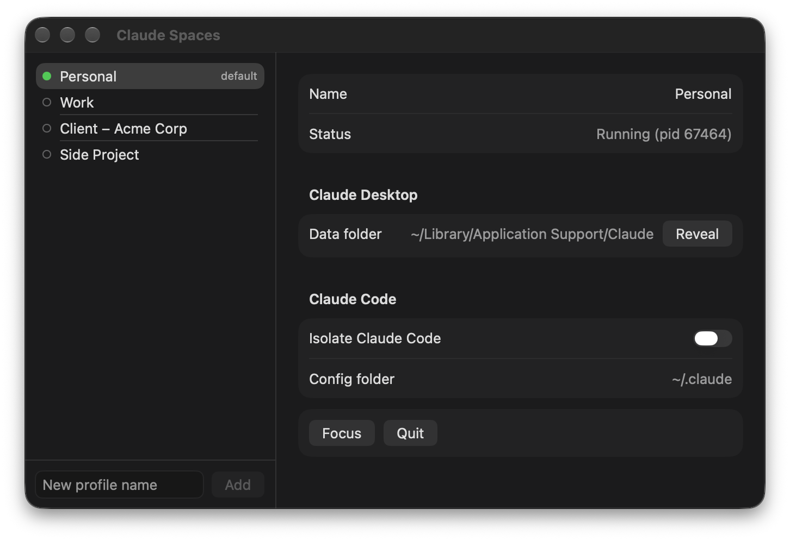

# Claude Spaces

A macOS menu bar app for running several Claude Desktop accounts side by side, such as
personal, work and client accounts. Each account keeps its own sign-in, chats,
connectors and, if you want, its own Claude Code configuration.

<p align="center">
  
</p>

## Why

Claude Desktop has no account switcher. The only built-in way to change accounts is to
sign out and sign back in. Electron apps do accept a `--user-data-dir` flag, though, so
you can run a second instance with a separate data folder:

```bash
open -n -a Claude --args --user-data-dir="$HOME/.claude-instances/work"
```

That works, but typing it every time is clumsy. Every instance also shows the same Dock
icon, and Claude Code sessions started from Desktop still read `~/.claude` unless you
also set `CLAUDE_CONFIG_DIR`. Claude Spaces handles all of this from the menu bar.

## Features

- **One click to switch.** Each profile is listed in the menu bar. Clicking one brings
  its window forward if it is already running and launches it if not. A green dot
  marks the profiles that are running, and ⌘1 to ⌘9 pick a profile while the menu is
  open.
- **Run accounts at the same time.** Every profile is its own Claude Desktop process
  with its own data folder, so you can have as many open as you like.
- **Your existing account is untouched.** The data you already have in
  `~/Library/Application Support/Claude` becomes the built-in default profile. Nothing
  is moved or copied.
- **Separate Claude Code per profile (optional).** Turn on *Isolate Claude Code* and
  the instance launches with `CLAUDE_CONFIG_DIR=~/.claude-<profile>`. Claude Code
  sessions started from that Desktop window then use their own login, settings and
  history.
- **Terminal aliases.** The app can write `claude-<profile>` aliases for the Claude Code
  CLI, for example `claude-work`, and keep them up to date as you add or remove
  profiles.
- **Stray instance detection.** If a Claude window is running with a data folder that
  doesn't belong to any profile, the menu lists it. A common cause is an auto-update
  restart that dropped the instance's launch flags.
- **Safe deletes.** Deleting a profile moves its folders to the Trash, so you can still
  restore them.
- **Launch at Login**, a native AppKit/SwiftUI interface, no Dock icon, no network
  access and no telemetry.

<p align="center">
  
</p>

## Requirements

- macOS 14 Sonoma or later
- [Claude Desktop](https://claude.ai/download)
- A Swift 5.10+ toolchain. The Xcode Command Line Tools are enough; full Xcode isn't
  needed.

## Install

```bash
git clone https://github.com/nasiridrishi/claude-spaces.git
```

```bash
cd claude-spaces && ./scripts/build-app.sh --install
```

```bash
open ~/Applications/"Claude Spaces.app"
```

The build script compiles a release binary, wraps it in `Claude Spaces.app` and signs
it ad hoc. With `--install` it also copies the app to `~/Applications`. Without
`--install`, the app is left in `build/`.

## Usage

### Menu bar (two-people icon)

| Action | What happens |
|---|---|
| Click a profile | Brings its window forward, or launches it if it isn't running |
| Hold ⌥ | Running profiles change to **Quit \<profile\>**. Stopped profiles change to **Reveal Data Folder** |
| **Manage Profiles… (⌘,)** | Opens the window shown above |
| **Launch at Login** | Starts Claude Spaces when you log in, via `SMAppService` |
| **Install CLI Aliases…** | Sets up the `claude-<profile>` aliases (see below) |

### Manage Profiles

- Add a profile by typing a name and pressing **Add**. New profiles have *Isolate
  Claude Code* turned on.
- Rename a profile in the **Name** field. Its folder names stay the same.
- Toggle **Isolate Claude Code**. If the profile is running, relaunch it for the change
  to take effect; the window reminds you when the running instance doesn't match.
- **Delete…** moves the profile's Desktop data folder and Claude Code folder to the
  Trash. You can't delete a running profile or the default one.

### CLI aliases

**Install CLI Aliases…** writes `~/.claude-instances/aliases.zsh` with one alias per
isolated profile:

```bash
alias claude-work='CLAUDE_CONFIG_DIR="$HOME/.claude-work" claude'
```

It then asks before adding a single `source` line to `~/.zshrc`. Open a new terminal,
run `claude-work`, and use `/login` once. Each config folder gets its own Keychain
entry, so you stay signed in from then on.

## Where things live

| What | Path |
|---|---|
| Profile list | `~/Library/Application Support/ClaudeSpaces/profiles.json` |
| Default profile's Desktop data | `~/Library/Application Support/Claude` |
| Other profiles' Desktop data | `~/.claude-instances/<profile>` |
| Isolated Claude Code config | `~/.claude-<profile>` |
| Shared Claude Code config | `~/.claude` |

## How it works

- Launching uses `NSWorkspace.openApplication` with `createsNewApplicationInstance`,
  `--user-data-dir=<folder>`, and `CLAUDE_CONFIG_DIR` in the environment when isolation
  is on. Electron's single-instance lock applies per data folder, which is why the
  instances can run side by side.
- Running instances are found by reading each Claude process's arguments and
  environment with `sysctl(KERN_PROCARGS2)`. The list refreshes on app launch and quit
  notifications, with no polling.
- Switching activates the matching process. If that process has no window open, the app
  sends it the same "reopen" Apple event the Dock sends on an icon click.

## Known limitations

- **Update restarts.** When Claude Desktop auto-updates and restarts, an instance can
  come back without its `--user-data-dir` and open as the default profile. If that
  happens, quit it and relaunch the profile from the menu.
- **One Dock icon.** All instances share the Claude Dock icon. The menu bar is how you
  tell them apart.
- **Disk use.** Each profile downloads its own copy of the Claude Code runtime, a few
  hundred MB.
- **Automation prompt.** The first time Claude Spaces reopens a window, macOS asks you
  to allow it to control Claude.
- **Ad-hoc signing.** The app is signed ad hoc for your own machine and isn't notarized.

## Development

```
Sources/ClaudeSpaces/
  main.swift                 App entry (accessory app, no Dock icon)
  AppDelegate.swift          Status item and NSMenu (AppKit, for ⌥ alternate items)
  ManageProfilesView.swift   Manage Profiles window (SwiftUI)
  Profile.swift              Profile model and paths
  ProfileStore.swift         Saving profiles to profiles.json
  InstanceLauncher.swift     Launch, focus, quit, reopen
  InstanceMonitor.swift      Detects running instances via KERN_PROCARGS2
  ShellAliases.swift         CLI alias file and the ~/.zshrc line
  LoginItem.swift            SMAppService wrapper
```

The SwiftUI view state lives in `ObservableObject`s rather than `@State`. On recent SDKs
`@State` is a macro, and its plugin is missing from the Command Line Tools, so code
using it won't build without Xcode.

## Disclaimer

Claude Spaces is an independent project. It isn't affiliated with or endorsed by
Anthropic. Claude is a trademark of Anthropic. The app only starts the official Claude
Desktop app with different launch arguments; it doesn't modify the app or read your
conversations.

## License

[MIT](LICENSE)
