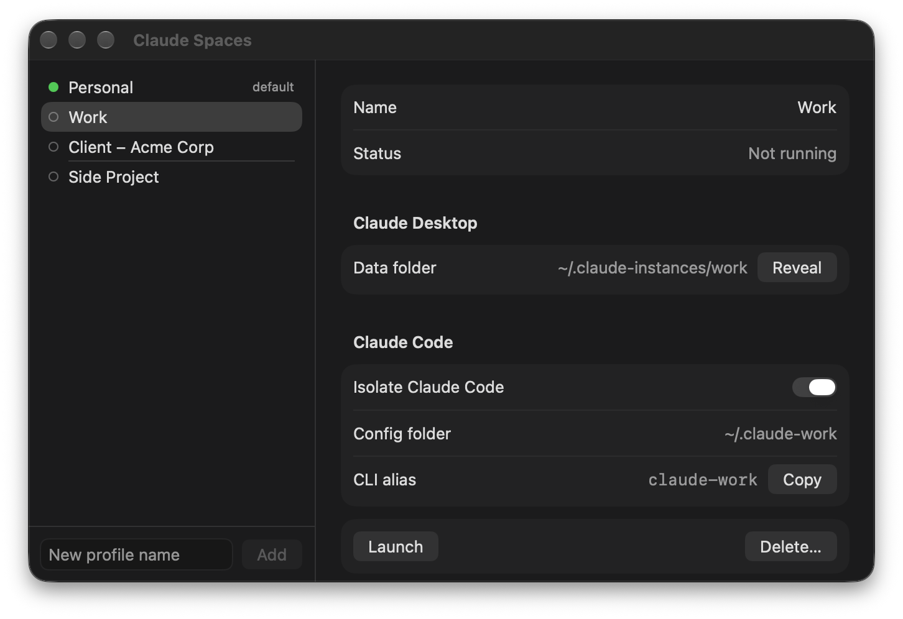

# Claude Spaces

A macOS menu bar app for running multiple Claude Desktop accounts side by side, each with
its own sign-in, chats and (optionally) Claude Code config.

<p align="center">
  
</p>

## Features

- Click a profile in the menu bar to launch it or bring it forward. Running profiles have a green dot.
- Profiles run at the same time, each as a separate Claude Desktop instance (`--user-data-dir`).
- Your existing account becomes the default profile. Its data stays where it is.
- Optionally give each profile its own Claude Code config (`CLAUDE_CONFIG_DIR`). The app can also add `claude-<profile>` aliases for the CLI.
- Launch at login. Deleted profiles go to the Trash.

## Install

Requires macOS 14+ and Claude Desktop. The Xcode Command Line Tools are enough to build it.

```bash
git clone https://github.com/nasiridrishi/claude-spaces.git && cd claude-spaces
./scripts/build-app.sh --install
open ~/Applications/"Claude Spaces.app"
```

## Notes

- Profile data lives in `~/.claude-instances/<profile>`. Isolated Claude Code configs live in `~/.claude-<profile>`.
- After Claude auto-updates, an instance may reopen as the default profile. If that happens, relaunch the profile from the menu.
- All instances share one Dock icon. Use the menu bar to tell them apart.

Not affiliated with Anthropic. [MIT](LICENSE)
